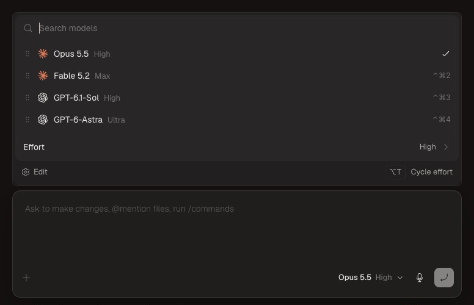
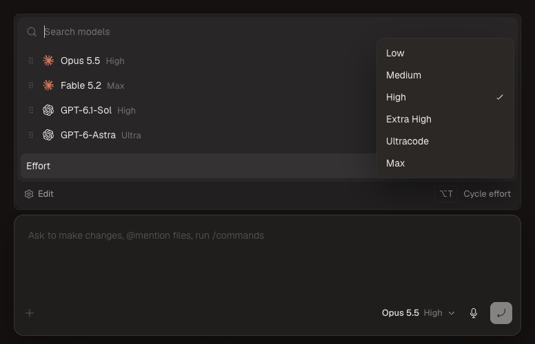
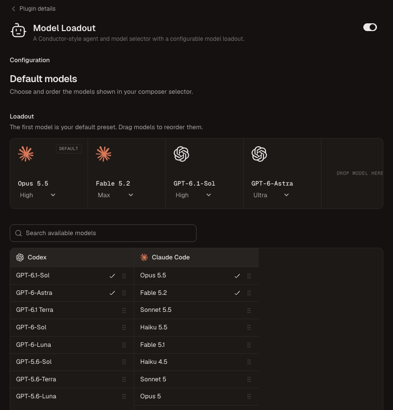

# Model Loadout

A Conductor-style model selector for BB.

Model Loadout replaces the native provider/model button in the composer with a
compact selector containing only the models you choose. The popup supports
search, reasoning effort, BB's fast service tier, and switching between
providers without leaving the composer.



Each model keeps its own reasoning effort. Change it from the **Effort** row:



## Install

```sh
bb plugin install git:https://github.com/promontis/bb-plugin-model-loadout.git@^0.1.0
```

## Configure the loadout

Open **Settings → Plugins → Model Loadout**, or choose **Edit loadout** at the
bottom of the selector.



The settings page lets you:

- keep up to five models in the selector;
- add models from every enabled provider;
- reorder the loadout by dragging cards;
- choose a default reasoning effort per model;
- remove a model by selecting it again in the provider list.

The loadout and its order are stored locally in BB's plugin storage. Available
providers and models always come from BB, so the selector follows the provider
accounts and model catalogs configured in the app.

## Development

```sh
npm install
npm run typecheck
npm test
bb plugin build .
bb plugin install . --yes
```

After source changes, rebuild and reload it with:

```sh
bb plugin build .
bb plugin reload model-loadout
```
